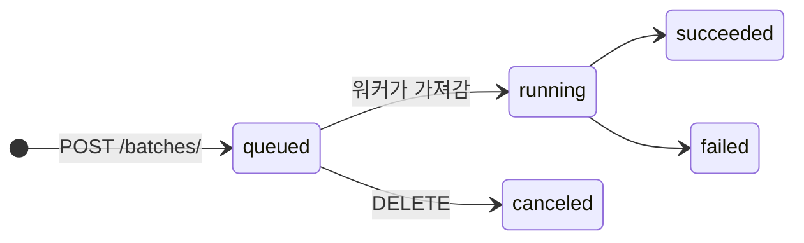

# MRX 배치 추론 데모
> MRX · 내부 시연용


**Swagger 접속 주소: https://port-0-mrx-mvhsm9yd86d534f8.sel3.cloudtype.app/docs#/**

##  4단계로 써보기
### 1. 배치 추론 잡 등록 — POST /batches/
아래 내용을 Request body로 요청한다

```json
{
  "model": "/models/yolo11/yolo11m.pt",
  "input_path": "/demo_images",
  "params": {
    "additionalProp1": {}
  },
  "idempotency_key": "{unique_key}" // 클라이언트가 Job을 구분 하기 유니크 키  
}
```


응답 예시
```json
{
  "id": 1,
  "job_type": "batch",
  "status": "queued", // <- Queued 상태
  "payload": {
    "model": "/models/yolo11m.pt",
    "input_path": "/demo_images",
    "params": {
      "additionalProp1": {}
    }
  },
  "result": null,
  "error": null,
  "worker_id": null,
  "idempotency_key": "{unique_key}",
  "created_at": "2026-10-22T05:43:33.632712",
  "updated_at": "2026-10-22T05:43:33.632712",
  "started_at": null,
  "finished_at": null
}
```


### 2. 상태 확인 — GET /batches/{batch_id}
batch_id에 1단계의 id를 넣고 요청한다. 잡 상태를 확인 할 수 있다. <br> 
queued → running → succeeded


### 3. 결과 보기 — GET /batches/{batch_id}
잡 상태가 succeeded가 되면 같은 응답의 result에 요약이 들어온다.


### 4. 목록 보기 · 취소

| API | 설명 |
|---|---|
| `GET /batches/` | 최근 등록한 잡부터 보입니다. `status`에 `queued`처럼 상태를 넣으면 그 상태만 거릅니다. |
| `DELETE /batches/{batch_id}` | 아직 `queued`인 잡만 취소됩니다. 이미 `running`이거나 끝난 잡은 409로 거절됩니다. |

---

## 잡 상태



| 상태 | 의미 |
|---|---|
| `queued` | 등록됨. 워커가 가져가길 기다리는 중 |
| `running` | 워커가 추론 중. 이때는 취소할 수 없음 |
| `succeeded` | 완료. `result`에 요약이 들어옴 |
| `failed` | 실패. `error`에 원인이 남음 |
| `canceled` | 대기 중에 취소됨. 워커가 가져가지 않음 |

---
